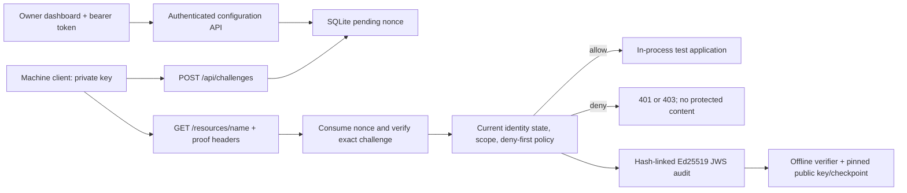

# Architecture and public interfaces

OwnerGate v0.1.0 is a controlled single-host pilot. Run one process / one worker.

`crypto.py` implements encoding and library calls; `engine.py` owns authentication
and policy decisions; `store.py` owns persistence and atomic operations;
`models.py` validates inputs; `app.py` implements transport and boundary controls;
`cli.py` is the server/client/offline verifier interface. Static assets contain
presentation and disposable lab actions only, with no authorization authority.

## Atomicity and persistence

SQLite WAL, BEGIN IMMEDIATE and an in-process lock serialize registry reads,
nonce consumption, policy evaluation and signed audit append. A failed audit
write prevents a successful response. The response content is copied from the
protected resource inside that transaction. Revocation takes effect for decisions
after its transaction commits; an earlier authorized in-flight response can finish.
Expired challenges are pruned and at most 2,048 live challenges are retained.
Nonces already consumed cannot be redeemed after restart. Startup verifies the
complete signed audit chain and refuses invalid history or a missing audit key.
Unsigned SQLite configuration is trusted local state: the audit makes changes
inspectable but startup does not replay it to validate all configuration tables.
A host compromise remains outside the trust boundary.

The test application is a registry of owner-defined documents at exact paths
`/resources/[a-z0-9-]+`. Every registered resource is protected immediately. There
is no upstream listening port, remote proxy target, file reader or arbitrary URL
fetcher. `/public` and `/health` are intentionally public. This is a real HTTP
boundary around this test application, not a general-purpose reverse proxy.

## Administration API

All `/api/admin/*` operations require `Authorization: Bearer <token>`; token is a
random secret (at least 32 characters) configured at startup. This pilot has one
owner role. There is no cookie auth or public administrative session creation.
The browser keeps the supplied token in tab memory only and clears it on reload.

| Method / path | Operation |
| --- | --- |
| GET `/api/admin/snapshot` | Registry, resources, policies, actual decisions and pinned audit key |
| POST `/api/admin/machines` | Register public key, self-declared operator, exact scopes and validity |
| PATCH `/api/admin/machines/{id}` | Active/suspended/revoked; revocation irreversible |
| POST `/api/admin/machines/{id}/rotate` | Owner-authorized key replacement with history; increments key version |
| PUT `/api/admin/resources` | Protect/replace an exact test resource |
| PUT `/api/admin/policies` | Validate and create/replace a uniquely identified rule |
| GET `/api/admin/audit/export` | Complete compact JWS records and checkpoint |
| GET `/api/admin/audit/verify` | Server-side signature/chain check (not independent trust) |

Request bodies are strict JSON objects; unknown fields and invalid times/scopes
are rejected. Examples appear in the dashboard and `scripts/pilot_demo.py`.
Credential validity is a server-held registry assertion, not a portable signed
credential presented by the machine. Signed administration records preserve
registration and lifecycle history. Enrollment/rotation trust the authenticated
owner; no independent legal operator verification is offered.

Every configuration mutation increments a global policy/configuration version.
Every gateway record carries that version and a digest of the full policy set.
Rules match exact resource, exact machine or `*`, action, and half-open UTC epoch
validity interval. Any matching deny wins; otherwise at least one matching allow
is required. Scope and lifecycle checks occur first and cannot be overridden by
policies. Restrictions on matching allows are returned as declarations. There
is no delete API: replace a rule or let it expire; use a deny for immediate blocks.

## HTTP protocol

See [PROTOCOL.md](PROTOCOL.md). `401` means no valid proof, `403` means a valid
proof was denied (including revoked/expired credentials), `422` rejects malformed
API inputs, `409` reports conflicting administration, and `429` limits abuse.
Unknown paths never disclose stored protected content. Early HTTP parser
rejections, disconnections and non-resource routes are outside the decision log.
